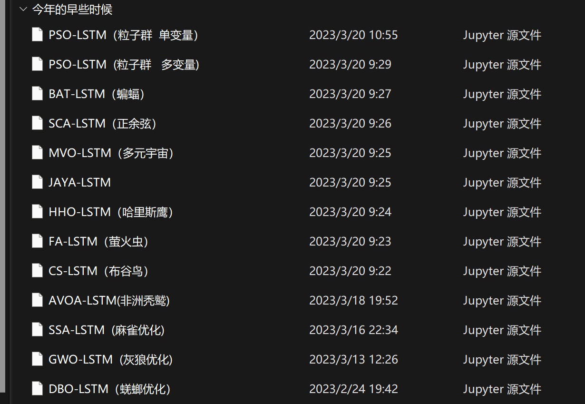

# Multiple Optimization Algorithms for Optimizing LSTM - Including: Particle Swarm, Bat, Positive Rotational, Multiverse, Positive Cosine, Harris Hawk... (Python code implementation)

Various optimization algorithms for optimizing LSTM (Python code implementation)
\n\nIncludes: Particle Swarm Optimization, Bat Algorithm, Orthogonal Rotation, Multiverse, Cosine Angle, JAYA, Harris Hawking, Firefly, Cuckoo, African Griffin, Sparrow Optimization, Grey Wolf Optimization, and Dung Beetle Optimization.

## Images

<!-- PAYMENT_BLOCK -->

## Get this dataset

- Payment link (Stripe): [Buy now](https://buy.stripe.com/3cs8yP7sY87d0vu9AB)
- Payment QR code: 

<!-- /PAYMENT_BLOCK -->
